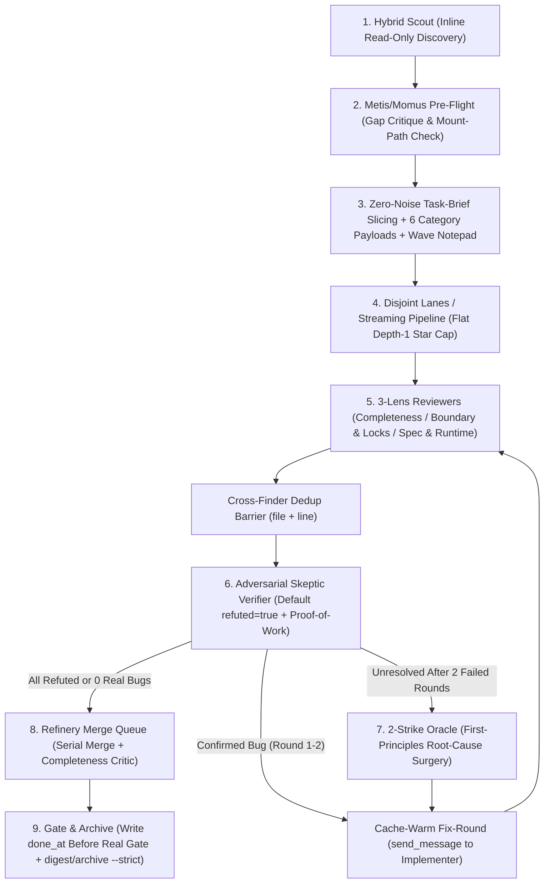

# Ultracode v2

English | [简体中文](README.md)

[](CHANGELOG.md)
[](https://github.com/cty12356541/ultracode)
[](https://github.com/cty12356541/agentdash)
[](LICENSE)

**A multi-phase subagent orchestration, semantic routing, and zero-trust adversarial verification suite for Google Antigravity (`agy` CLI / Antigravity 2.0 / IDE).**

---

## Overview

`Ultracode v2` transforms complex software engineering in Antigravity from fragile single-window marathons or blind subagent fan-outs into **auditable, context-rot-resistant, zero-trust multi-agent waves**. It distills battle-tested harness engineering patterns from three leading AI coding ecosystems into native Antigravity primitives (`invoke_subagent`, `define_subagent`, `send_message`, `manage_subagents`):

- **Claude Code Ecosystem**: Incorporates built-in `Coordinator / Workflow` discipline (top-level coordinator focuses on synthesis and boundary enforcement without directly editing lane source files; explicit `Streaming Pipeline` vs `True Barrier` control flow), `Superpowers` (anti-lazy zero-noise `Task-Brief` slicing plus dual-stage compliance & quality review), `Gas Town Refinery` (DAG ledger gating and the dedicated `Refinery` serial merge queue), and direct-to-disk scratch offloading for large intermediate artifacts.
- **OpenAI Codex Ecosystem**: Integrates anti-`Context Rot` sub-window distillation, structured batch fan-out (`Work-List Map-Reduce`), isolated Git Worktree bootstrapping, and `Symphony`-style deterministic `Proof-of-Work` gates.
- **OpenCode / `OMO` (Oh My OpenCode) Ecosystem**: Brings pre-flight dual-critic gating (`Metis` gap & anti-AI-slop analysis + `Momus` static verification of real runtime mount paths and test scripts), 6 `Category + Skill` behavioral payloads, append-only cross-wave wisdom (`Wave Notepads`), the `"Subagents Lie"` zero-trust axiom, and `2-Strike Oracle` first-principles root-cause escalation after two consecutive failed fix rounds.
- **Seamless Synergy with [`cty12356541/agentdash`](https://github.com/cty12356541/agentdash) (`--host agy`)**: Built from the ground up for deterministic subagent slot attribution, `Hook-Safe` word-boundary protection in read-only sessions, `done_at <= last_gate_passed` gate folding without `done ?` warnings, and zero-unclosed-agent `archive --strict` closing.

---

## Architecture & Orchestration Topology



---

## Quick Installation

Clone the repository and run the idempotent installer on Windows PowerShell ([`install.ps1`](install.ps1)) or macOS / Linux / Git Bash ([`install.sh`](install.sh)):

```bash
git clone https://github.com/cty12356541/ultracode.git
cd ultracode
```

### Mode 1 · Global Plugin + Standing Rule Registration (Recommended Default)

Installs `Ultracode v2` as a standard Antigravity plugin under `~/.gemini/config/plugins/ultracode/`, **idempotently merges** the `<!-- ultracode:begin v2 --> ... <!-- ultracode:end -->` standing rule block from [`AGENTS.global.md`](AGENTS.global.md) into `~/.gemini/AGENTS.md` (preserving `agentdash` and all existing user rules), and automatically deduplicates any legacy standalone `~/.gemini/config/skills/ultracode` directory to prevent duplicate skill loading:

```powershell
# Windows PowerShell
.\install.ps1
```

```bash
# macOS / Linux / Git Bash
./install.sh
```

### Mode 2 · Standalone Skill Mode

Installs only the standalone skill directory at `~/.gemini/config/skills/ultracode/` (without registering the plugin bundle). Append `-NoGlobalRule` / `--no-global-rule` to skip injecting the standing rule into `~/.gemini/AGENTS.md`:

```powershell
# Windows PowerShell
.\install.ps1 -SkillOnly
# Optional: install skill only without modifying ~/.gemini/AGENTS.md
.\install.ps1 -SkillOnly -NoGlobalRule
```

```bash
# macOS / Linux / Git Bash
./install.sh --skill-only
# Optional: install skill only without modifying ~/.gemini/AGENTS.md
./install.sh --skill-only --no-global-rule
```

### Mode 3 · Per-Project Workspace Installation

Installs `Ultracode v2` into a single target repository by idempotently updating `<project-path>/AGENTS.md` and syncing the skill to `<project-path>/.agents/skills/ultracode/`, leaving global `~/.gemini` settings untouched:

```powershell
# Windows PowerShell
.\install.ps1 -Target <project-path>
```

```bash
# macOS / Linux / Git Bash (also accepts ./install.sh --target <project-path>)
./install.sh <project-path>
```

### Mode 4 · Clean Uninstall

Surgically removes the `<!-- ultracode:begin v2 --> ... <!-- ultracode:end -->` block from `~/.gemini/AGENTS.md` (preserving `agentdash` and other user rules) and removes `~/.gemini/config/plugins/ultracode/` and `~/.gemini/config/skills/ultracode/`:

```powershell
# Windows PowerShell
.\install.ps1 -Uninstall
```

```bash
# macOS / Linux / Git Bash
./install.sh --uninstall
```

---

## Core Capabilities Panorama

### 1. Topology, Control Flow & Context Economics Invariants

| Core Discipline | Mechanism | Engineering Problem Solved |
| :--- | :--- | :--- |
| **`Standing Opt-In` Top-Level Scope Guard** | Only the top-level coordinator activates multi-agent orchestration; spawned subagents (carrying `<subagent_reminder>`) skip reading `SKILL.md`, never invoke nested subagents, complete their `Task-Brief`, and report explicitly via `send_message`. | Prevents solo multi-module coordinator edits while eliminating recursive subagent runaway and dropped replies. |
| **`Hybrid Scout → Pre-Flight → Task-Brief`** | Starts with 1–2 lightweight inline read-only scout steps; large waves run `Metis` (blind spots & anti-AI-slop) + `Momus` (dead-code check, real runtime mount paths, verification script existence); coordinator synthesizes self-contained `Task-Brief` slices with exact `file + exactLineRanges`, contracts, and exclusive write allowlists. | Eliminates blind fan-outs, edits to unmounted dead files, and lazy prompts such as *"fix based on earlier findings"*. |
| **`Streaming Pipeline` vs `True Barrier`** | Defaults to streaming per-item pipelines whenever stages have no cross-item dependency (wall-clock converges to slowest single chain $\max_i(\sum_s t_{i,s})$); synchronizes at a `True Barrier` only for `file+line` cross-finder dedup, `0 findings` early exit, `Judge Panel` synthesis, and `Refinery` multi-lane merge planning. | Removes stage-wide straggler stalls across independent lanes. |
| **`Flat Depth-1 Star Topology Cap`** | Strictly enforces a single-layer star topology—no subagent may call `invoke_subagent`. Implementers resolve local questions via read-only tools or escalate broad cross-subsystem blockers to the coordinator. | Prevents exponential token blowup, concurrent worktree write collisions, and `--host agy` `is_dispatcher` unclosed-session failures. |
| **Anti-`Context Rot` & Wave Notepads** | Defaults to `Model: "inherit"`; `self` workers offload large outputs directly to `<artifactDir>/scratch/` and return path pointers, while `research` workers distill noisy inputs in isolated read-only sandboxes; `send_message` reuses warm cache for `fix-round`s while `invoke_subagent` guarantees zero confirmation bias for Reviewers/Verifiers; cross-wave lessons accumulate append-only in `<artifactDir>/scratch/<wave>-notepad.md`. | Preserves high signal-to-noise ratio in the coordinator context while maximizing cache hits and review independence. |

### 2. Six Semantic Category Behavioral Payloads (`Category + Skill`)

| Semantic Category | Cognitive Profile & Target Tasks | Injected Behavioral Guardrails |
| :--- | :--- | :--- |
| **`visual-engineering`** | Frontend UI/UX, component styling, motion, responsive layouts & dashboards | Pre-checks design invariants and color tokens; forbids hardcoded raw colors or off-scale opacity; enforces `tabular-nums` on KPIs/tables; requires desktop/mobile multi-viewport and light/dark theme verification. |
| **`ultrabrain`** | Core architecture, concurrency/SSE idempotency races, 64-bit integer precision, complex SQL metrics | Traces end-to-end data flow and state lifecycles from first principles; targets minimal leverage points instead of symptom-masking patches; adds edge-race unit assertions. |
| **`deep`** | Multi-file autonomous refactoring, deep root-cause debugging | Enforces a mandatory **`Silent Exploration`** phase—traces all callers, callees, type contracts, and existing tests before touching code; zero mid-flight hand-holding, end-to-end green completion. |
| **`quick`** | Deterministic single-file localized adjustments | Locks strictly onto coordinator-supplied `FILE:L1-L2` anchors; re-reads context before editing and forbids drive-by refactoring outside the target range. |
| **`audit-sweep`** | Repository-wide compliance sweeps, dead-reference / hardcoded-literal audits | Automatically binds `Multi-Modal Sweep` + `Loop-Until-Dry (Seen-Set)` + `No Silent Caps`; emits unique `file:line:symbol` keys distinguishing mounted runtime code from dead files. |
| **`writing-spec`** | Architecture specs, API contracts, open-source documentation & technical reports | Strips filler prose; mandates clickable file/symbol links, exact JSON Schemas, state/topology diagrams, and copy-pasteable verification commands. |

### 3. Seven Zero-Trust Quality Patterns & `2-Strike Oracle` Escalation

Grounded in the **`"Subagents Lie"`** axiom (never trust self-reported completion without deterministic `Proof-of-Work`: `git status/diff`, `zeroForbiddenFilesTouched === true`, and real `EXIT=0` verification runs), `Ultracode v2` composes seven quality patterns:

| # | Pattern Name | Control-Flow Shape | Key Safeguard Invariant |
| :---: | :--- | :--- | :--- |
| **1** | **`Adversarial Verify`** | Per-lane `Streaming Pipeline` | Independent Skeptic subagent **defaults to `refuted=true`** (presuming false positive), inspects exact source lines, and runs targeted checks to disprove each claim; only unrefuted claims (`isRealBug: true`) enter fix rounds. |
| **2** | **`Perspective-Diverse 3 Lenses`** | 3-way fan-out → `file+line` dedup barrier | Parallel orthogonal reviewers cover `Completeness & Backlog` (runtime mount & requirements), `Boundary & Static Locks` (exclusive allowlists, build/hash/i18n locks), and `Spec & Runtime` (tokens, precision, resource leaks). |
| **3** | **`Judge Panel & Grafting`** | 3-way proposals → `Judge` synthesis barrier | Explores open design spaces across three orthogonal angles (`Minimal-Intrusion MVP`, `UX Excellence`, `Edge-Case Bulletproofing`) before a Judge grafts the best safeguards onto the winning backbone with TDD task breakdown. |
| **4** | **`Loop-Until-Dry with Seen-Set Dedup`** | Barrier loop until $K$ consecutive zero-fresh rounds | Deduplicates each round against the full historical **`seen`** set (including legitimately exempted items)—never against `confirmed` alone—preventing infinite exemption re-flagging loops. |
| **5** | **`Multi-Modal Sweep`** | 4-way orthogonal fan-out → union barrier | Searches independently by directory container (`by-container`), lexical/AST content (`by-content`), call-graph entity (`by-entity`), and Git history (`by-time`). |
| **6** | **`Completeness Critic`** | Pre-signoff single gatekeeper | Cross-checks live `git status --porcelain=v1 -uall` and requirement ledgers to catch any missed file, hunk, assertion, or static lock before wave signoff. |
| **7** | **`No Silent Caps`** | Global invariant across all phases | Forbids silent `.slice()` truncation; any skipped directory or sampling cap must explicitly report skipped paths, total counts, and justification. |

> **Bounded Fix-Rounds & `2-Strike Oracle` Circuit Breaker**: Confirmed `blocker / major` bugs return to the original implementer session via `send_message` (`max_rounds = 3`). If the same defect **fails to converge after 2 consecutive `fix-round` attempts or triggers cascading regressions**, local patching stops immediately: the coordinator pauses the session (killing runaway agents via `manage_subagents(Action: "kill")`) and spawns a fresh read-only `[<Task-ID>-Oracle]` (`ultrabrain` payload) to diagnose the true architectural root cause and emit a surgical `ORACLE_DIAGNOSIS_SCHEMA` plan.

---

## Repository Layout & Reference Index

```text
ultracode/
├── plugin.json                                     # Antigravity plugin manifest (v2.0.0)
├── AGENTS.global.md                                # Standing global rule block template (<!-- ultracode:begin v2 -->)
├── assets/
│   └── logo.svg                                    # Vector plugin icon
├── skills/
│   └── ultracode/
│       ├── SKILL.md                                # Master orchestration protocol, invariants & --host agy rules
│       └── references/
│           ├── prompt-templates.md                 # 6 semantic category blocks + 14 subagent prompt templates
│           └── quality-patterns-and-playbooks.md   # 7 quality patterns matrix + 9 JSON Schemas + 7 playbooks
├── install.ps1                                     # Windows PowerShell 4-mode idempotent installer/uninstaller
├── install.sh                                      # macOS / Linux / Git Bash 4-mode idempotent installer/uninstaller
├── tests/
│   └── verify-suite.mjs                            # Zero-dependency contract, sanitization & sandbox installer suite
├── README.md                                       # Simplified Chinese documentation (primary)
├── README.en.md                                    # English documentation
├── CHANGELOG.md                                    # Release history (Keep a Changelog)
├── LICENSE                                         # MIT License
└── .gitignore                                      # Git ignore rules
```

| Core Asset | Contents Summary |
| :--- | :--- |
| [`skills/ultracode/SKILL.md`](skills/ultracode/SKILL.md) | `Standing Opt-In` scope boundary, 3 control-flow invariants, model/cache economics, `--host agy` hook rules, zero-trust verification axiom, and Playbooks A–G overview. |
| [`skills/ultracode/references/prompt-templates.md`](skills/ultracode/references/prompt-templates.md) | **6 semantic category blocks** + **14 ready-to-use subagent templates**: (1) `Metis & Momus` Pre-Flight Critic, (2) `Deep Scout`, (3) Orthogonal Proposal Architect, (4) `Judge` Synthesis Architect, (5) Worktree Lane Implementer, (6) Disjoint Sub-Track Implementer, (7) `Map-Reduce` Chunk Worker, (8–10) Orthogonal 3-Lens Reviewers (`RevA` / `RevB` / `RevC`), (11) `Adversarial Skeptic` Verifier, (12) `Oracle` Root-Cause Architect, (13) `Completeness Critic`, and (14) `Refinery` Merge Guard & Signoff. |
| [`skills/ultracode/references/quality-patterns-and-playbooks.md`](skills/ultracode/references/quality-patterns-and-playbooks.md) | **7 Quality Patterns selection matrix** + **9 Structured JSON Schemas** (`PREFLIGHT_CRITIC_SCHEMA`, `SCOUT_SCHEMA`, `PROPOSAL_SCHEMA`, `FINAL_SPEC_SCHEMA`, `REVIEW_SCHEMA`, `VERDICT_SCHEMA`, `ORACLE_DIAGNOSIS_SCHEMA`, `CHUNK_RESULT_SCHEMA`, `REFINERY_SIGNOFF_SCHEMA`) + **7 Engineering Playbooks** (`Loop-Until-Dry Sweep`, `Disjoint Sub-Track Parallel Implement`, `Audit Worktree Split`, `Merge Guard + Refinery + Final Signoff`, `Append-Only Scratch Wave Notepads`, `Work-List Map-Reduce`, and `2-Strike Oracle + Multi-Viewport Gate + Strict Ledger Closing`). |

---

## Synergy with `agentdash` (`--host agy`)

When orchestrating waves alongside [`cty12356541/agentdash`](https://github.com/cty12356541/agentdash), `Ultracode v2` enforces five hook-level compatibility guarantees:

1. **Keep `Workspace: "inherit"` by Default**: Never pass `"branch"` when invoking subagents; instead, lock each worker to its explicit `<worktree_path>` inside the `Prompt` so subagent `Stop` hooks record cleanly into the main repository's `.agentdash/events.jsonl`.
2. **Unique First-80-Char `[<Task-ID>]` Attribution**: Every subagent's `Role` and the first 80 characters of its `Prompt` first line must be unique and start with `[<Task-ID>]` (e.g., `[W2-L1]`, `[W2-L1-RevA]`), preventing `hook.rs` `who`-slot collisions caused by shared boilerplate prefixes.
3. **Flat `Depth-1` Closure Safety**: Because subagents never invoke `invoke_subagent`, they are never flagged as `is_dispatcher = true` and never skip emitting their own `completed` events; aborted or timed-out workers are cleaned up via `manage_subagents(Action: "kill")`, which automatically closes their pending slots.
4. **`Hook-Safe` Word-Boundary Discipline for Read-Only Probes**: `agentdash` scans the entire `CommandLine` by word boundaries (quotes are not word characters, so even searching for a gate phrase inside quotes triggers gate logging). Read-only scouts and reviewers must never include verification gate trigger phrases anywhere in shell command strings.
5. **`done_at <= last_gate_passed` Closing Sequence**: At lane signoff, update `.agentdash/ledger.json` with `"state": "done"` and the current RFC 3339 `"done_at"` **immediately before** running the real project verification gate from the top-level coordinator in the main workspace—ensuring `last_gate_passed >= done_at` (eliminating `done ?` suspect flags)—followed by `agentdash render digest --strict`, `agentdash stats --host agy`, and `agentdash archive --strict` with zero warnings.

---

## Self-Check & Verification

Run the built-in zero-dependency verification suite [`tests/verify-suite.mjs`](tests/verify-suite.mjs) to validate plugin manifest integrity, skill/reference completeness, zero-leak open-source sanitization, and isolated sandbox install/uninstall idempotency across all four modes:

```bash
node tests/verify-suite.mjs
```

---

## License

Released under the [MIT License](LICENSE) (Copyright (c) 2026 Tianyu Cheng).
