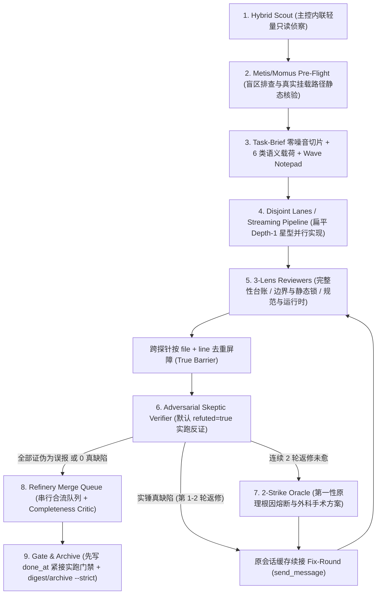

# Ultracode v2

[English](README.en.md) | 简体中文

[](CHANGELOG.md)
[](https://github.com/cty12356541/ultracode)
[](https://github.com/cty12356541/agentdash)
[](LICENSE)

**面向 Google Antigravity（`agy` CLI / Antigravity 2.0 / IDE）的多阶段子智能体编排、语义路由与零信任对抗验证套件。**

---

## 定位概述

`Ultracode v2` 将复杂软件工程研发从“单智能体长窗口硬扛或盲目大扇出”升级为**可审计、防上下文腐烂（Anti-Context-Rot）、默认零信任证伪**的结构化多智能体波次管线。套件深度融合三大主流 AI Coding 阵营的核心调度精髓，并原生映射至 Antigravity 原语（`invoke_subagent` / `define_subagent` / `send_message` / `manage_subagents`）：

- **Claude Code 阵营精华**：吸收内置 `Coordinator / Workflow`（顶层主控专注合成调度与边界守卫，不越界抢改子泳道源码；严格区分 `Streaming Pipeline` 与 `True Barrier`）、`Superpowers`（反懒惰零噪音单任务切片 `Task-Brief`、合规与质量双阶审查）、`Gas Town Refinery`（DAG 台账依赖门控与 `Refinery` 专职串行合流队列），以及大体积中间产物直写磁盘绕过主控窗口瓶颈。
- **OpenAI Codex 阵营精华**：融合防 `Context Rot` 独立子窗口蒸馏、结构化工作项批量扇出归并（`Work-List Map-Reduce`）、隔离 Git Worktree 引导，以及 `Symphony` 确定性硬物证门禁（`Proof-of-Work`）。
- **OpenCode / `OMO`（Oh My OpenCode）阵营精华**：引入规划前置双视角挑刺（`Metis` 排查隐含盲区与过度设计 + `Momus` 静态核验真实挂载路径与验收脚本）、`Category + Skill` 6 类认知语义行为载荷、跨波次只增不减智慧便签（`Wave Notepads`）、`"Subagents Lie"` 零信任反撒谎公理，以及连续 2 轮返修未愈强制触发的 `2-Strike Oracle` 第一性原理根因熔断会诊。
- **与 [`cty12356541/agentdash`](https://github.com/cty12356541/agentdash)（`--host agy`）无缝协同**：从子会话实名槽位归因、只读探针 `Hook-Safe` 词边界防误触，到防 `done ?` 存疑标记的门禁折叠顺序与 `archive --strict` 零挂起收口，实现全生命周期确定性追踪。

---

## 架构与编排拓扑



---

## 快速安装

克隆仓库到本地后，可通过 Windows PowerShell（[`install.ps1`](install.ps1)）或 macOS / Linux / Git Bash（[`install.sh`](install.sh)）执行幂等安装：

```bash
git clone https://github.com/cty12356541/ultracode.git
cd ultracode
```

### 模式 1 · 本机全局插件 + 常驻规则注册（默认推荐）

将 `Ultracode v2` 作为标准 Antigravity 插件安装至 `~/.gemini/config/plugins/ultracode/`，并将 [`AGENTS.global.md`](AGENTS.global.md) 中的 `<!-- ultracode:begin v2 --> ... <!-- ultracode:end -->` 常驻规则段**幂等合入** `~/.gemini/AGENTS.md`（无损保留 `agentdash` 及用户既有自定义规则，同时自动检测并清理旧版独立目录 `~/.gemini/config/skills/ultracode` 防止技能双份重复加载）：

```powershell
# Windows PowerShell
.\install.ps1
```

```bash
# macOS / Linux / Git Bash
./install.sh
```

### 模式 2 · 纯独立 Skill 模式

仅安装独立技能目录至 `~/.gemini/config/skills/ultracode/`（不注册插件包形态）；如需跳过写入 `~/.gemini/AGENTS.md` 全局常驻规则，可附加 `-NoGlobalRule` / `--no-global-rule`：

```powershell
# Windows PowerShell
.\install.ps1 -SkillOnly
# 可选：仅安装 Skill，不注入全局 AGENTS.md 常驻规则段
.\install.ps1 -SkillOnly -NoGlobalRule
```

```bash
# macOS / Linux / Git Bash
./install.sh --skill-only
# 可选：仅安装 Skill，不注入全局 AGENTS.md 常驻规则段
./install.sh --skill-only --no-global-rule
```

### 模式 3 · 单项目工作区安装

仅针对指定代码仓库启用 `Ultracode v2`，幂等写入 `<项目路径>/AGENTS.md` 标记段并同步技能至 `<项目路径>/.agents/skills/ultracode/`，不改动本机全局 `~/.gemini` 配置：

```powershell
# Windows PowerShell
.\install.ps1 -Target <项目路径>
```

```bash
# macOS / Linux / Git Bash（同样支持 ./install.sh --target <项目路径>）
./install.sh <项目路径>
```

### 模式 4 · 干净卸载

精准剥离 `~/.gemini/AGENTS.md` 中的 `<!-- ultracode:begin v2 --> ... <!-- ultracode:end -->` 标记段（完整保留 `agentdash` 与其他自定义规则），并移除 `~/.gemini/config/plugins/ultracode/` 与 `~/.gemini/config/skills/ultracode/`：

```powershell
# Windows PowerShell
.\install.ps1 -Uninstall
```

```bash
# macOS / Linux / Git Bash
./install.sh --uninstall
```

---

## 核心能力全景

### 1. 拓扑、控制流与上下文经济学铁律

| 核心纪律 | 机制要义 | 解决的工程痛点 |
| :--- | :--- | :--- |
| **`Standing Opt-In` 顶层作用域守卫** | 仅顶层主控会话无条件启用多智能体编排；被派生的子智能体（含 `<subagent_reminder>`）免读 `SKILL.md`、严禁套娃派生，单兵闭环后经 `send_message` 显式回传结果。 | 杜绝主控单兵手写跨模块大改动，同时阻断子会话递归失控与漏发回传消息。 |
| **`Hybrid Scout → Pre-Flight → Task-Brief`** | 扇出前先在主控内联 1–2 步轻量只读摸底；大型波次经 `Metis`（盲区/防过度设计）与 `Momus`（死代码/真实挂载路径/脚本存在性）前置挑刺；主控消化勘测结论产出含精确 `file + exactLineRanges`、契约与独占白名单的零噪音 `Task-Brief`。 | 根治盲目大扇出、“改在未挂载死文件上”以及“按前文发现去改”等懒惰指令导致的上下文污染。 |
| **`Streaming Pipeline` vs `True Barrier`** | 单泳道/单模块内无跨项依赖时默认流式推进（先回先审，总挂钟耗时收敛于最慢单链 $\max_i(\sum_s t_{i,s})$）；仅在跨探针 `file+line` 去重、`0 findings` 早退、`Judge Panel` 评审与 `Refinery` 跨泳道合流时设同步屏障。 | 消除“全员苦等最慢节点”造成的阶段性空转延迟。 |
| **`Flat Depth-1 Star Topology Cap`** | 强制保持单层扁平星型拓扑，严禁任何子智能体再次调用 `invoke_subagent`；局部疑问由实现者就地只读自查，跨子系统阻塞报回主控统一代扇出。 | 防止 Token 指数爆炸、同工作树写踩踏及 `--host agy` `is_dispatcher` 槽位未闭合故障。 |
| **防 `Context Rot` 与跨波次智慧便签** | 默认继承最高推理档位（`Model: "inherit"`）；`self` 分片节点大体积产物直写 `<artifactDir>/scratch/` 仅回传路径指针，`research` 纯只读沙箱窗口蒸馏噪音；紧耦合追问与 `fix-round` 用 `send_message` 命中会话缓存，审查与证伪用 `invoke_subagent` 全新无偏见隔离；跨波次经验只增不减沉淀于 `<artifactDir>/scratch/<wave>-notepad.md`。 | 保持主控窗口高信噪比，兼顾缓存复用率与零确认偏见（Zero Confirmation Bias）。 |

### 2. 六大语义类别行为载荷 (`Category + Skill Payloads`)

| 语义类别 | 认知画像与适用任务 | 注入的核心行为约束 |
| :--- | :--- | :--- |
| **`visual-engineering`** | 前端 UI/UX、组件样式、动效、响应式看板与投屏 | 动笔前预检设计语言不变量与色彩令牌规范；严禁硬编码裸色或非规范透明度；KPI/表格数值强制 `tabular-nums` 等宽对齐；覆盖桌面/移动多视口与浅深双主题实证。 |
| **`ultrabrain`** | 核心架构、并发/流式 SSE 幂等防重竞态、64 位整数精度、复杂 SQL 口径 | 第一性原理追踪完整调用链与状态生命周期；定位最小侵入杠杆点（Minimal Leverage Point），拒绝掩盖症状的表层补丁；补齐极端竞态边界单测。 |
| **`deep`** | 跨文件自主重构、深水区复杂故障排障 | 强制执行**静默深读期（`Silent Exploration`）**——改代码前先完整追踪 caller / callee / 类型契约 / 既有单测涟漪效应，零半途反问，端到端跑通验证。 |
| **`quick`** | 单文件确定性局部微调 | 严格锁定主控给定的 `FILE:L1-L2` 锚点，改前只读校验上下文，禁止顺手重构周边代码或扩大修改半径。 |
| **`audit-sweep`** | 全仓合规清零、死引用/裸文案/裸色盘点 | 自动绑定 `Multi-Modal Sweep` + `Loop-Until-Dry (Seen-Set)` + `No Silent Caps`，逐条输出精确 `file:line:symbol` 唯一键并区分运行时挂载路径与死代码。 |
| **`writing-spec`** | 架构规格书、接口契约、开源文档与深度调研报告 | 剔除空洞套话，强制提供可点击文件符号链接、精确 JSON Schema、状态流转拓扑图与可直接复制执行的验收命令。 |

### 3. 七大零信任质量编排模式与 `2-Strike Oracle` 熔断

基于 **`"Subagents Lie"`（默认不采信子智能体口头报捷）** 前置公理，所有改动必须提交硬物证（`git status/diff`、`zeroForbiddenFilesTouched === true`、实跑目标验证脚本退出码 `EXIT=0`），并按需组合以下质量模式：

| # | 模式名称 | 控制流形态 | 核心防雷机制 |
| :---: | :--- | :--- | :--- |
| **1** | **`Adversarial Verify`（对抗证伪）** | 单链 `Streaming Pipeline` | 独立 Skeptic 子智能体**默认置 `refuted=true`（怀疑初审误报）**，亲自核对源码精确行号并实跑验证试图推翻指控；唯有反证失败才确认为 `isRealBug: true`。 |
| **2** | **`Perspective-Diverse 3 Lenses`（三透镜正交审查）** | 3 路扇出 → `file+line` 去重屏障 | 强制从 `Completeness & Backlog`（需求与真实挂载闭环）、`Boundary & Static Locks`（白名单边界与构建/哈希/多语种静态锁）、`Spec & Runtime`（规范、精度与异常泄漏）三正交维度独立挑刺。 |
| **3** | **`Judge Panel & Grafting`（方案竞赛与优胜嫁接）** | 3 路提案 → `Judge` 合成屏障 | 宽设计空间下按 `MVP 最小侵入角`、`极致 UX 交互角`、`极端防雷与可测性角` 独立盲写提案，由评委择优主干并嫁接其余防雷亮点产出 TDD 拆解规格。 |
| **4** | **`Loop-Until-Dry with Seen-Set Dedup`（穷尽清零循环）** | 轮次屏障循环至连续 $K$ 轮零新增 | 每轮新发现必须比对历史全量已评估集合 **`seen`**（含曾被判合法豁免项），严禁仅比对 `confirmed`，彻底消除豁免项反复重报的死循环。 |
| **5** | **`Multi-Modal Sweep`（多模态正交盲搜）** | 4 路正交扇出 → 并集去重屏障 | 按目录容器（`by-container`）、词法/AST（`by-content`）、实体调用链（`by-entity`）、Git 历史（`by-time`）四维独立盲搜取并集。 |
| **6** | **`Completeness Critic`（终局完整性审计）** | 波次收口单点守门员 | 合流签收前对照实时 `git status --porcelain=v1 -uall` 与需求台账排查任何漏网文件、代码 hunk、边界断言或静态校验锁。 |
| **7** | **`No Silent Caps`（零静默截断）** | 全程全局不变量 | 严禁对扫描结果静默 `.slice()` 截断；凡设置采样上限或跳过目录，必须显式披露略过路径、总数与原因。 |

> **有界返修环与 `2-Strike Oracle` 根因熔断**：实锤的 `blocker / major` 缺陷经 `send_message` 打回原实现会话执行原地 `fix-round`（上限 3 轮）。一旦同一问题在**连续 2 轮 `fix-round` 后仍未收敛或引发连环回归**，主控立即熔断叫停局部打补丁，派生全新只读 `[<Task-ID>-Oracle]`（`ultrabrain` 载荷）从第一性原理重审全链路并输出 `ORACLE_DIAGNOSIS_SCHEMA` 外科手术方案（跑偏会话通过 `manage_subagents(Action: "kill")` 回收）。

---

## 仓库结构与参考库索引

```text
ultracode/
├── plugin.json                                     # Antigravity 插件清单 (v2.0.0)
├── AGENTS.global.md                                # 全局常驻规则标记段模板 (<!-- ultracode:begin v2 -->)
├── assets/
│   └── logo.svg                                    # 插件矢量徽标
├── skills/
│   └── ultracode/
│       ├── SKILL.md                                # 编排总纲：拓扑铁律、语义路由、零信任模式与剧本映射
│       └── references/
│           ├── prompt-templates.md                 # 6 大语义载荷积木 + 14 套子智能体标准 Prompt 模板
│           └── quality-patterns-and-playbooks.md   # 7 大质量模式速查表 + 9 大 JSON Schema + 7 大实战剧本
├── install.ps1                                     # Windows PowerShell 四模式幂等安装/卸载脚本
├── install.sh                                      # macOS / Linux / Git Bash 四模式幂等安装/卸载脚本
├── tests/
│   └── verify-suite.mjs                            # 零依赖静态契约、脱敏守卫与沙箱安装/卸载验证套件
├── README.md                                       # 简体中文主文档
├── README.en.md                                    # 英文完整版文档
├── CHANGELOG.md                                    # 版本变更日志 (Keep a Changelog)
├── LICENSE                                         # MIT 开源许可证
└── .gitignore                                      # Git 忽略规则
```

| 核心资产文件 | 收录内容索引 |
| :--- | :--- |
| [`skills/ultracode/SKILL.md`](skills/ultracode/SKILL.md) | `Standing Opt-In` 顶层作用域边界、三大控制流铁律、算力与缓存经济学、`--host agy` 钩子对齐纪律、零信任验收公理及剧本 A–G 总览。 |
| [`skills/ultracode/references/prompt-templates.md`](skills/ultracode/references/prompt-templates.md) | **6 类语义载荷积木** + **14 套即插即用子智能体模板**：① `Metis & Momus` 规划挑刺官、② `Deep Scout` 深读探针、③ 正交视角架构提案官、④ `Judge` 优胜嫁接评委、⑤ Worktree 泳道实现者、⑥ 同树零交集子分轨实现者、⑦ `Map-Reduce` 分片执行工、⑧–⑩ 正交三透镜审查官（`RevA` / `RevB` / `RevC`）、⑪ `Adversarial Skeptic` 证伪官、⑫ `Oracle` 根因会诊官、⑬ `Completeness Critic` 终局完整性审计官、⑭ `Refinery` 合流预审与签收官。 |
| [`skills/ultracode/references/quality-patterns-and-playbooks.md`](skills/ultracode/references/quality-patterns-and-playbooks.md) | **7 大质量模式选型矩阵** + **9 大结构化 JSON Schema**（`PREFLIGHT_CRITIC_SCHEMA`、`SCOUT_SCHEMA`、`PROPOSAL_SCHEMA`、`FINAL_SPEC_SCHEMA`、`REVIEW_SCHEMA`、`VERDICT_SCHEMA`、`ORACLE_DIAGNOSIS_SCHEMA`、`CHUNK_RESULT_SCHEMA`、`REFINERY_SIGNOFF_SCHEMA`）+ **7 大实战工程剧本**（穷尽清零循环、同树无交集子分轨并发、脏工作树逐 Hunk 剥离审计、跨泳道 `Refinery` 串行合流、跨波次 `Scratch Wave Notepads`、`Work-List Map-Reduce`、`2-Strike Oracle` + 真机多视口门禁 + 严格台账收口）。 |

---

## 与 `agentdash` (`--host agy`) 协同要点

搭配 [`cty12356541/agentdash`](https://github.com/cty12356541/agentdash) 运行多轨波次编排时，`Ultracode v2` 内置以下五项钩子兼容保障：

1. **保持 `Workspace: "inherit"` 默认继承**：派生子智能体时切勿传 `"branch"`，而是在 `Prompt` 中显式锁死专属 `<worktree_path>` 绝对路径，确保子会话结束时 `Stop` 钩子准确归档至主仓 `.agentdash/events.jsonl`。
2. **首行前 80 字符唯一 `[<Task-ID>]` 归因**：每个子智能体的 `Role` 与 `Prompt` 第一行前 80 个字符必须唯一且以 `[<Task-ID>]`（如 `[W2-L1]`、`[W2-L1-RevA]`）开头，防止 `hook.rs` 反查实名 `who` 槽位时因公共前缀相同而互相覆盖。
3. **单层 `Depth-1` 保护闭合状态机**：子智能体严禁调用 `invoke_subagent`，避免子会话因触发 `dispatched` 被标记为 `is_dispatcher = true` 而跳过自身 `completed` 事件；对超时或熔断废弃的子会话调用 `manage_subagents(Action: "kill")` 自动补齐闭合记录。
4. **只读会话 `Hook-Safe` 词边界禁令**：`agentdash` 按词边界扫描整条 `CommandLine`（引号不属于词字符，在搜索参数中写出门禁词同样会触发门禁登记）。因此只读探针与审查员执行的任何命令行字符串严禁包含验证门触发词。
5. **`done_at <= last_gate_passed` 收口时序**：泳道合流收口时，先在 `.agentdash/ledger.json` 写入 `"state": "done"` 与当前 RFC 3339 `"done_at"`，**紧接着由顶层主控在主工作区实跑真实项目门禁**使 `last_gate_passed >= done_at`（消除 `done ?` 存疑标记），最后依次运行 `agentdash render digest --strict`、`agentdash stats --host agy` 与 `agentdash archive --strict` 完成零告警归档。

---

## 自检与验证

仓库内置零外部依赖的自动化验证套件 [`tests/verify-suite.mjs`](tests/verify-suite.mjs)，用于校验插件清单、技能与参考文档完整性、开源脱敏规则以及隔离临时沙箱下的四模式安装/卸载幂等性：

```bash
node tests/verify-suite.mjs
```

---

## 许可证

本项目基于 [MIT License](LICENSE) 开源（Copyright (c) 2026 Tianyu Cheng）。
